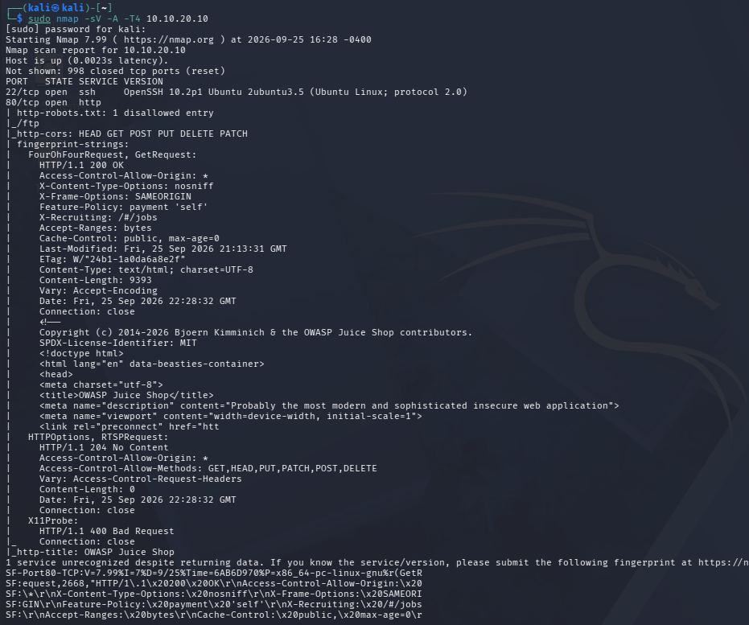
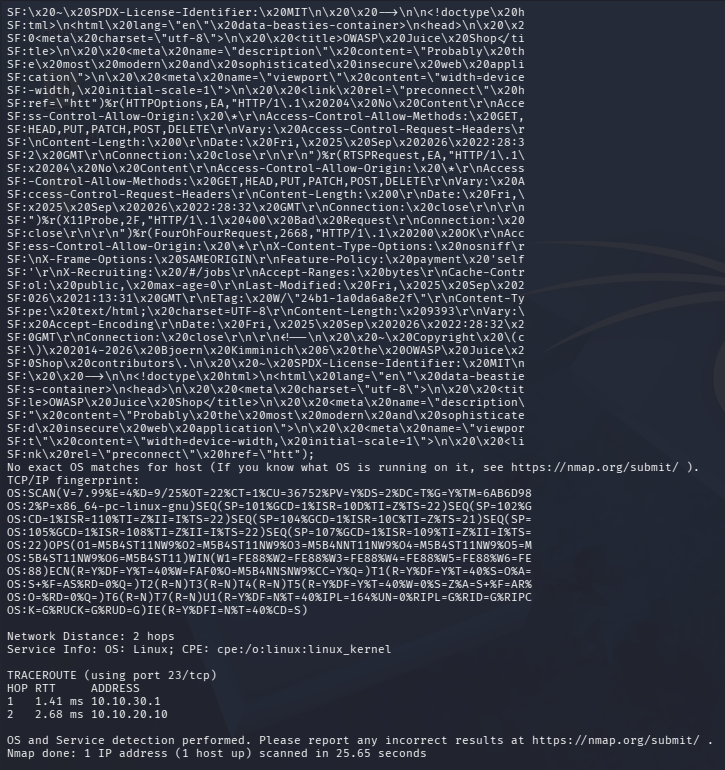
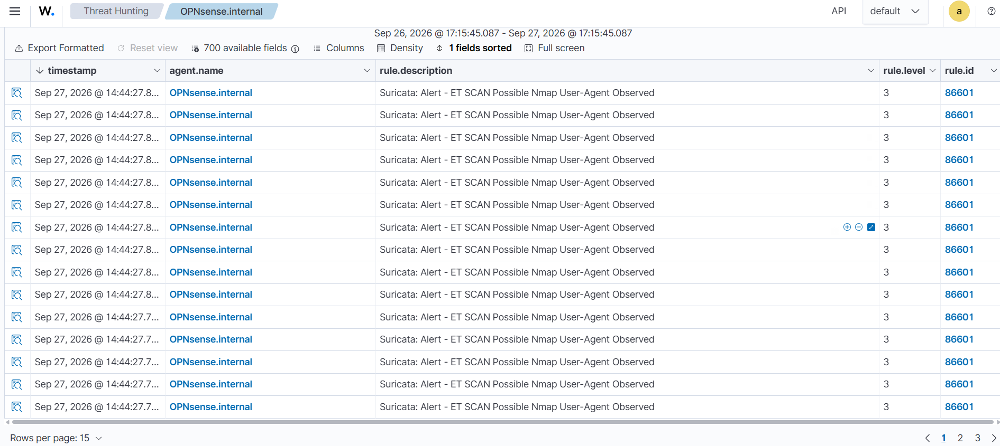

# Scenario 02 — Ricognizione di rete con Nmap (Kali → DMZ)

> **Stato:** Concluso · **Tecnica MITRE:** T1046, T1595
> **Data esecuzione:** 27/09/2026 

---

## 1. Obiettivo

Simulare la fase di **ricognizione** di un attaccante che, ottenuto un accesso nella rete, effettua una scansione dell'host esposto in DMZ (web server Juice Shop) per identificare porte aperte, servizi e versioni. Lato difensivo l'obiettivo è verificare **cosa rileva l'IDS (Suricata)** e **cosa passa inosservato**.

## 2. Contesto e ambiente

| Elemento | Valore |
|---|---|
| Attaccante | Kali Linux — rete ATTACK (10.10.30.0/24) |
| Bersaglio | Ubuntu Server DMZ — `10.10.20.10` (Juice Shop, porta 80→3000) |
| Percorso | Kali → OPNsense (routing) → DMZ. Traffico ATTACK→DMZ **consentito** dalle regole firewall |
| Sensore IDS | Suricata su interfacce DMZ e ATTACK — ruleset ET Open |
| Log IDS | `/var/log/suricata/eve.json` (in locale su OPNsense, poi rilevati da agent Wazuh e visibili nella dashboard) |

Diagramma di riferimento: vedi [`docs/architecture.md`](../docs/architecture.md).

## 3. Esecuzione dell'attacco

### 3.1 Comando eseguito

```bash
sudo nmap -sV -A -T4 10.10.20.10
```

Flag utilizzati:

| Flag | Effetto | Rilevanza difensiva |
|---|---|---|
| `-sV` | Service/version detection | Genera probe applicativi mirati, molto visibili all'IDS |
| `-A` | Aggressive: OS detection + NSE scripts + traceroute | Massima rumorosità, ideale per testare la detection |
| `-T4` | Timing aggressivo | Scansione rapida → pattern facilmente riconoscibile come scan |

> Scansione volutamente "rumorosa" (`-A -T4`): l'obiettivo di questo scenario è verificare la capacità di rilevamento dell'IDS in condizioni favorevoli al difensore. In seguito i risultati verranno paragonati con uno scan più *evasivo* (`-T1`, single-port, `-sT`).

### 3.2 Risultati della scansione




**Ambiente rilevato:** Nmap 7.99 · host up (latenza 0.0023s) · **998 porte TCP chiuse** (risposta `reset`, quindi host raggiungibile e non filtrato) · scansione completata in 25.65s.

**Porte aperte:**

| Porta | Stato | Servizio | Versione |
|---|---|---|---|
| 22/tcp | open | ssh | OpenSSH 10.2p1 Ubuntu 2ubuntu3.5 (protocol 2.0) |
| 80/tcp | open | http | OWASP Juice Shop (Node.js/Express — non identificato con esattezza da Nmap) |

**Informazioni raccolte sul servizio web (porta 80):**

- `http-title`: **OWASP Juice Shop**
- `http-robots.txt`: 1 voce non consentita → **`/ftp`** (percorso potenzialmente interessante per un attaccante)
- `http-cors`: metodi permessi `HEAD GET POST PUT DELETE PATCH` + `Access-Control-Allow-Origin: *` (CORS permissivo)
- Header applicativi esposti: `Feature-Policy: payment 'self'`, `X-Recruiting: /#/jobs`, `X-Frame-Options: SAMEORIGIN`, `X-Content-Type-Options: nosniff`
- Nmap non ha riconosciuto con esattezza il servizio ("1 service unrecognized despite returning data") pur avendone ottenuto il fingerprint completo.

**OS detection:** nessun match esatto (`No exact OS matches`). CPE dedotta: `cpe:/o:linux:linux_kernel` — Service Info: OS Linux.

**Traceroute** (2 hop) — conferma il percorso di rete atteso:

| Hop | RTT | Indirizzo | Nodo |
|---|---|---|---|
| 1 | 1.41 ms | 10.10.30.1 | Gateway OPNsense (interfaccia ATTACK) |
| 2 | 2.68 ms | 10.10.20.10 | Host bersaglio in DMZ |

> **Osservazione:** già dalla sola ricognizione l'attaccante ottiene informazioni utili — il percorso di rete (Kali attraversa il firewall per raggiungere la DMZ), la presenza di SSH esposto (superficie per lo scenario di brute force), e indizi applicativi (`/ftp`, endpoint `/#/jobs`) sfruttabili nella fase di attacco web.

## 4. Rilevamento difensivo

### 4.1 Alert generati da Suricata (visti in Wazuh)

Gli alert di Suricata vengono rilevati dall'agent Wazuh installato su OPNsense
(lettura di `/var/log/suricata/eve.json`) e sono visibili nella dashboard SIEM
in *Threat Hunting*, filtrando per `rule.groups:suricata`.



_Alert rilevato durante lo scan:_

| Campo | Valore |
|---|---|
| rule.description | Suricata: Alert - **ET SCAN Possible Nmap User-Agent Observed** |
| rule.id (Wazuh) | 86601 |
| rule.level (Wazuh) | 3 (basso) |
| Agent | OPNsense.internal |
| Timestamp | 27/09/2026 ~14:44 |
| SID Suricata (`data.alert.signature_id`) | _da confermare aprendo un alert_ |
| Src → Dst | 10.10.30.x (Kali) → 10.10.20.10 (DMZ) |

**Osservazione:** con lo scan `-sV -A -T4`, la firma che ha fatto match
è di livello applicativo — **il User-Agent di Nmap** osservato durante il
probing HTTP del servizio web (categoria `emerging-scan`). È un rilevamento a
severità bassa (level 3). Il fatto che l'alert principale sia sul *User-Agent*
e non su firme di port-scan puro è un dato interessante, ripreso in 4.2.

Estrazione equivalente dei campi da `eve.json` (sul firewall):

```bash
cat /var/log/suricata/eve.json | jq 'select(.event_type=="alert") |
  {ts:.timestamp, sig:.alert.signature, sid:.alert.signature_id,
   cat:.alert.category, src:.src_ip, dst:.dest_ip, dport:.dest_port}'
```

> Nota architetturale: l'ingest verso Wazuh ha richiesto di
> risolvere due problemi — Suricata che non ripartiva dopo il reboot e i permessi
> di `eve.json` (ricreato `root -rw-------`, illeggibile all'agent). Entrambi
> resi persistenti da un watchdog via cron. Dettagli in
> [`docs/post-reboot-persistence.md`](../docs/post-reboot-persistence.md).

### 4.2 Cosa NON è stato rilevato

Suricata, net test effettuato e con i ruleset utilizzati, ha rilevato solo il campo user-agent 'nmap' (pacchetti HTTP). L'IDS non ha riportato alert per le scansioni SYN utilizzati per enumerazione e OS detection.

## 5. Mappatura MITRE ATT&CK

| Tecnica | ID | Note |
|---|---|---|
| Network Service Discovery | **T1046** | Enumerazione porte/servizi sull'host DMZ (SSH, HTTP) |
| Active Scanning: Scanning IP Blocks | **T1595.001** | Scansione dell'host in DMZ |
| Active Scanning: Vulnerability Scanning | **T1595.002** | Service/version detection e NSE (`-sV -A`) |

## 6. Conclusioni e raccomandazioni difensive

Il ruleset ET Open ha rilevato il tentativo di scanning con nmap, sollevando un alert di livello basso (3).
Tuttavia il traffico rilevato dall'IDS è solo parte dell'attacco completo portato a termine (il port scan SYN vero e proprio è passato inosservato).
La regola di rilevazione attuale è facilmente bypassabile: una modifica all'header analizzato non farebbe scattare nessun alert, rendendo l'attacco completamente silenzioso.
L'impostazione di regole a soglia sul firewall rappresenta un'ulteriore misura implementabile, anch'essa debole perchè eludibile con scansioni lente.
La misura più concreta, come visto nel primo laboratorio, sarebbe la riduzione delle superfici d'attacco (ad esempio chiusura porta ssh, se servizio è inutilizzato).

## 7. Lezioni imparate / note operative

---

_Write-up parte del progetto [Home Lab difensivo — Network Security](../README.md)._
