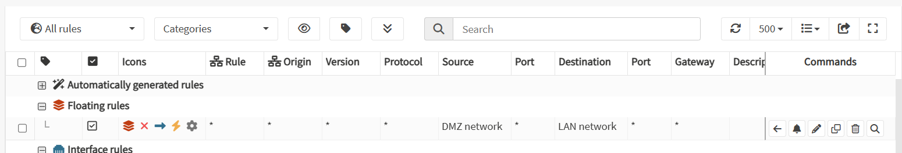
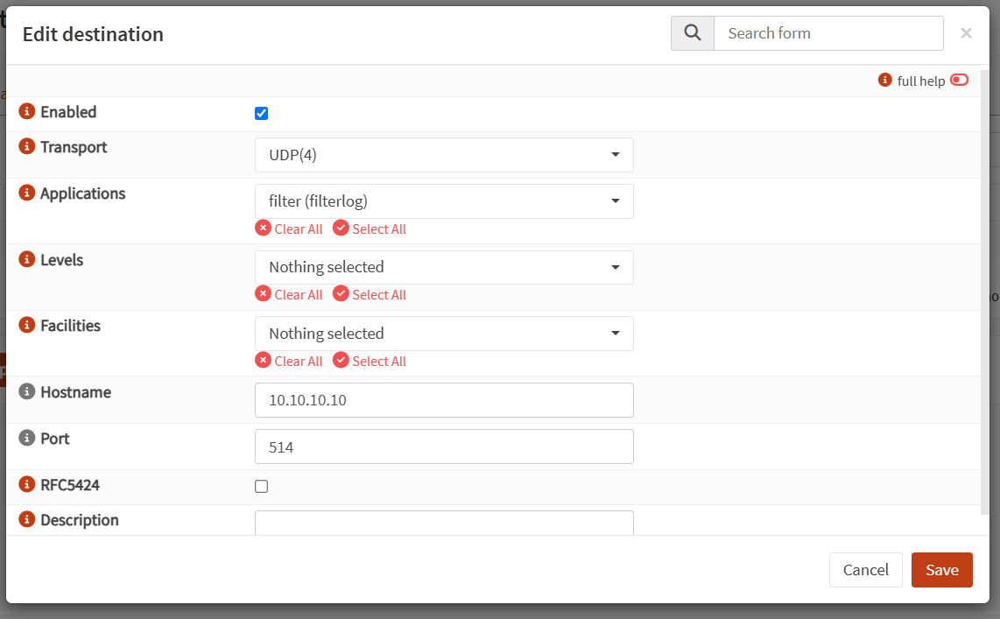
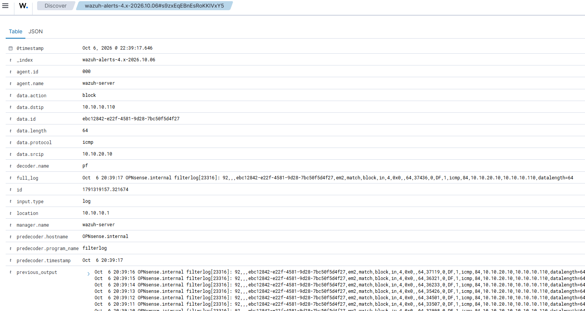
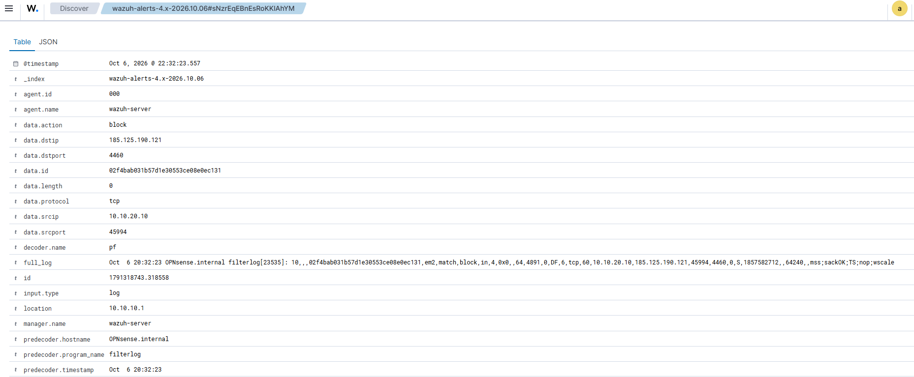

# Scenario 04 — Movimento laterale DMZ→LAN (host compromesso → rete interna)


> **Stato:** Concluso · **Tecnica MITRE:** T1190, T1595.003
> **Data esecuzione:** ottobre 2026 
---

## 1. Obiettivo

Simulare il **movimento laterale** di un attaccante che ha già compromesso un host
in DMZ e tenta di raggiungere la **rete interna (LAN)**. Obiettivi:
 verificare che la **segmentazione** di OPNsense blocchi il traffico DMZ→LAN, e
(2) rendere quei blocchi **osservabili e centralizzati** nel SIEM, portando i log del
firewall dentro Wazuh via syslog.

## 2. Contesto e ambiente

| Elemento | Valore |
|---|---|
| Host compromesso (attaccante) | Ubuntu DMZ — `10.10.20.10` (rete DMZ) |
| Bersaglio | Rete LAN `10.10.10.0/24` (es. Wazuh `10.10.10.10`, host `10.10.10.110`) |
| Firewall / segmentazione | OPNsense (interfaccia DMZ `em2`) |
| Centralizzazione log | OPNsense → **syslog UDP 514** → Wazuh `10.10.10.10` (decoder `pf`) |
| Rilevamento | Deny firewall ingeriti in Wazuh + telemetria Suricata già attiva |

Diagramma di riferimento: vedi [`docs/architecture.md`](../docs/architecture.md).

## 3. Esecuzione dell'attacco

Dalla VM DMZ compromessa, tentativi di raggiungere la LAN con tecniche tipiche di
ricognizione/pivot:

```bash
ping -c3 10.10.10.10
nmap -sS -p 22,443,1514,55000 10.10.10.10
ssh adv@10.10.10.10
```

**Esito atteso e osservato:** tutti i tentativi **falliti** (timeout / `filtered`).
La segmentazione impedisce alla DMZ di entrare in LAN.
L'attacco che *fallisce* è il risultato difensivo previsto e coerente con la segmentazione. La prova dei tentativi
bloccati è visibile lato detection (§4.3, raffica di deny in `previous_output`).

## 4. Rilevamento difensivo

### 4.1 Il firewall blocca e **logga** (non basta il deny implicito)

In OPNsense la DMZ (interfaccia firewall OPT) parte con **deny implicito** e blocco su TCP/UDP, che però **non
lascia traccia** nei log se non configurato. Per rendere il blocco osservabile ho
creato una regola esplicita **Block + Log** DMZ→LAN, con **Protocol: any** (per
intercettare anche ICMP, non solo TCP/UDP).



### 4.2 Dal log locale al SIEM (integrazione firewall→Wazuh via syslog)

I log del firewall vivono in formato `clog` sul disco di OPNsense: un agent che li
legge grezzi rischia dati illeggibili. Più robusto e realistico: **inviarli via
syslog** al manager Wazuh, che li riceve come testo pulito e li decodifica con il
decoder **`pf`** (plugin del SIEM).



### 4.3 Il deny DMZ→LAN visto in Wazuh

Rilanciato l'attacco, il blocco compare centralizzato in Wazuh (Discover):

| Campo | Valore |
|---|---|
| decoder.name | **pf** |
| data.action | **block** |
| data.srcip | **10.10.20.10** (DMZ, host compromesso) |
| data.dstip | **10.10.10.110** (LAN, bersaglio) |
| data.protocol | icmp / tcp |
| predecoder.program_name | filterlog |



La segmentazione tiene **anche in uscita**: gli stessi meccanismi registrano
il blocco di tentativi DMZ→Internet non consentiti.



### 4.4 Doppia telemetria e normalizzazione dei campi

Nel SIEM confluiscono ora **due sorgenti**: il **firewall** (decoder `pf`) e
**Suricata** (eve.json). Nota operativa importante: usano **campi diversi** per lo
stesso concetto — il firewall usa `data.dstip`, Suricata usa `data.dest_ip`. È il
tipo di **normalizzazione tra sorgenti** che in un SOC va gestita per correlare.

## 5. Mappatura MITRE ATT&CK

| Tecnica | ID | Note |
|---|---|---|
| Remote Services | **T1021** | Tentativo di pivot DMZ→LAN (SSH, scansione servizi interni) |
| Network Service Discovery | **T1046** | nmap verso l'host interno |

## 6. Conclusioni e raccomandazioni difensive

Questo laboratorio evidenzia l'importanza della segmentazione nel bloccare i tentativi di lateral movement e scansione effettuati da un attaccante già presente nella rete.
Includere nella regola di deny ogni protocollo ('any') ha permesso di bloccare non solo le scansioni con nmap (a livello TCP o UDP, ad esempio) ma anche tutte le altre effettuabili con altri protcolli, ad esempio un ping echo (ICMP) su un range di indirizzi.
La sola capacità del sistema di bloccare i pacchetti tra le varie sottoreti è, da sola, una misura incompleta: è fondamentale che il firewall generi dei log (il default-deny di OPNsense non logga, bisogna abilitare l'opzione) in modo che chi si occupa della sicurezza dell'infrastruttura possa rilevare l'attacco in atto.
Una risposta veloce ed efficace è facilitata dal collezionamento dei log in una piattaforma centralizzata SIEM (nel nostro caso Wazuh), che permette di vedere tutti gli alert che si verificano nella rete in real time.


## 7. Lezioni imparate / note operative
Questo laboratorio ha mostrato come la rilevazione di tutti i protocolli, non solo TCP o UDP (in questo esempio si è visto con ICMP), da parte del firewall sia fondamentale per osservare eventuali tentativi di ricognizione della rete.
Altrettanto importante è fare in modo che gli eventi del firewall vengano loggati e siano accessibili dal SIEM, permettendo così un'analisi facilitata e più efficace.
Con il reindirizzamento dei log verso Wazuh 
- Le regole firewall devono usare **Protocol: any** per intercettare anche **ICMP**
  (non solo TCP/UDP) — altrimenti il ping cade nel default-deny silenzioso.
- Il **default-deny di OPNsense non logga** se non abilitato → serve una regola
  Block esplicita con **Log** attivo.
- **Triage corretto:** prima il log locale del firewall, poi il SIEM. *Il SIEM non
  può vedere ciò che il firewall non logga.*
- I log OPNsense sono in formato `clog` → l'inoltro via **syslog** evita il parsing
  del file grezzo ed è il metodo standard firewall→SIEM.
- **Normalizzazione campi**: `data.dstip` (firewall/`pf`) ≠ `data.dest_ip`
  (Suricata) — da tenere a mente quando si filtra/correla.

---

_Write-up parte del progetto [Home Lab difensivo — Network Security](../README.md)._
